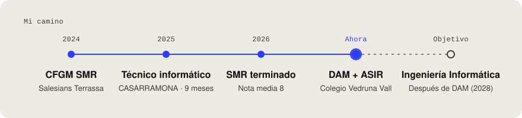
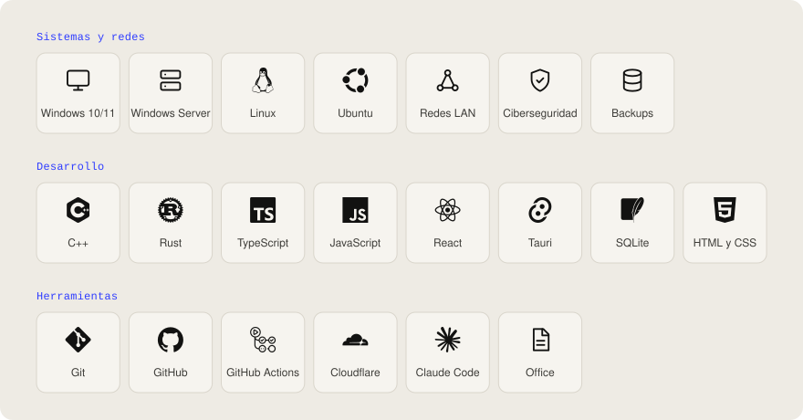
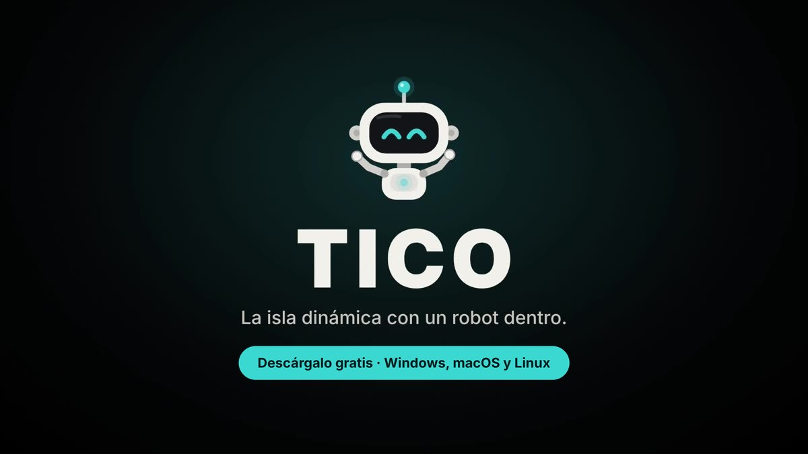
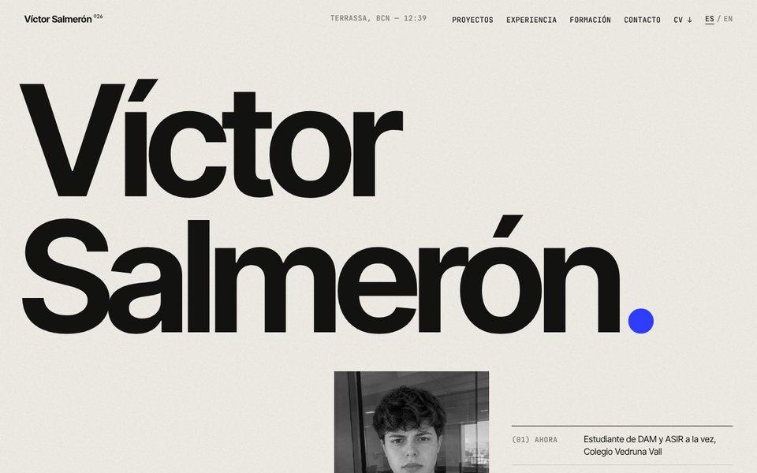
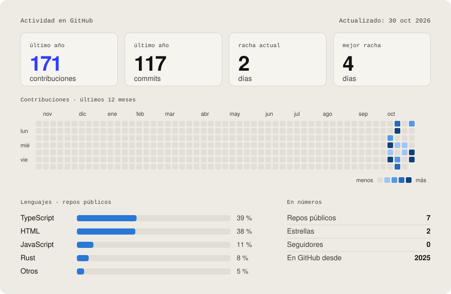
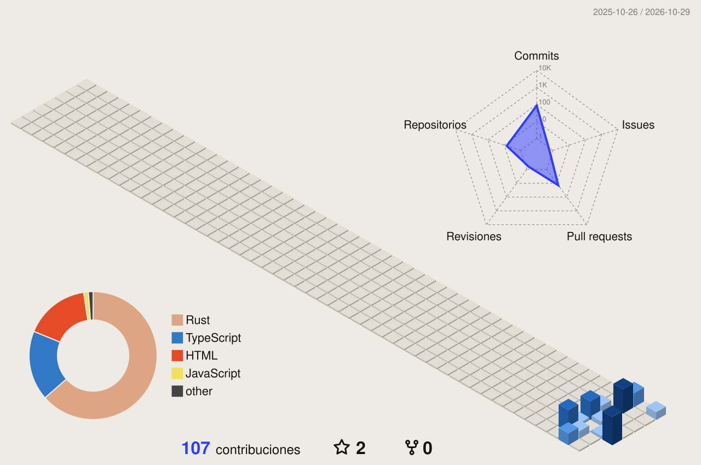
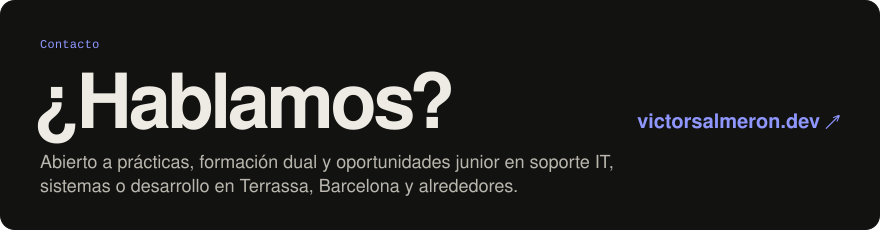

<a href="https://victorsalmeron.dev/">
  <picture>
    <source media="(prefers-color-scheme: dark)" srcset="assets/banner-dark.svg">
    
  </picture>
</a>

  
  
  
  

<picture>
  <source media="(prefers-color-scheme: dark)" srcset="assets/terminal-dark.svg">
  
</picture>

### ⚡ Ahora mismo

- 🎓 Estudiando **DAM y ASIR a la vez** en el Colegio Vedruna Vall (Terrassa).
- 🧠 Aprendiendo **C++** y mejorando en sistemas Windows y Linux.
- 🤖 Desarrollando **TICO**, mi asistente de escritorio con IA.
- 🔎 Buscando **prácticas o mi primer puesto junior** en soporte IT, sistemas o desarrollo.
- 🗣️ Castellano y catalán nativos · inglés B2.

<picture>
  <source media="(prefers-color-scheme: dark)" srcset="assets/camino-dark.svg">
  
</picture>

### 🧰 Tecnologías

<picture>
  <source media="(prefers-color-scheme: dark)" srcset="assets/tecnologias-dark.svg">
  
</picture>

### 🚀 Proyectos

<table>
  <tr>
    <td width="42%"></td>
    <td>
      <b>TICO AI Assistant</b> 
      Un pequeño robot que vive en la parte de arriba de la pantalla, chatea contigo y, solo cuando se lo pides, mira tu pantalla para ayudarte.
        
      App de escritorio para <b>Windows, macOS y Linux</b>: 6 versiones publicadas, 12 proveedores de IA, OCR, datos en local y publicación automática con GitHub Actions.
        
      <code>Tauri</code> <code>Rust</code> <code>TypeScript</code> <code>SQLite</code>
        
      <a href="https://victorsalmeron.dev/TICO-AI-ASSITANT/">Ver web ↗</a> · <a href="https://github.com/salmeronvictor486-lang/TICO-AI-ASSITANT">Código ↗</a>
    </td>
  </tr>
  <tr>
    <td width="42%"></td>
    <td>
      <b>victorsalmeron.dev</b> 
      Mi web personal: portfolio, experiencia, formación y CV en castellano e inglés.
        
      Sin frameworks, sin cookies, con política de seguridad estricta y publicada con GitHub Pages y dominio propio en Cloudflare.
        
      <code>HTML</code> <code>CSS</code> <code>JavaScript</code> <code>GSAP</code>
        
      <a href="https://victorsalmeron.dev/">Ver web ↗</a> · <a href="https://github.com/salmeronvictor486-lang/salmeronvictor486-lang.github.io">Código ↗</a>
    </td>
  </tr>
</table>

### 📊 Actividad

<picture>
  <source media="(prefers-color-scheme: dark)" srcset="assets/dashboard-dark.svg">
  
</picture>

<picture>
  <source media="(prefers-color-scheme: dark)" srcset="profile-3d-contrib/3d-dark.svg">
  
</picture>

<picture>
  <source media="(prefers-color-scheme: dark)" srcset="assets/snake-dark.svg">
  
</picture>

 

<a href="https://victorsalmeron.dev/">
  <picture>
    <source media="(prefers-color-scheme: dark)" srcset="assets/contacto-dark.svg">
    
  </picture>
</a>

  
   
  Todas las imágenes se generan con <code>scripts/perfil.mjs</code> y se actualizan solas cada día con GitHub Actions.

